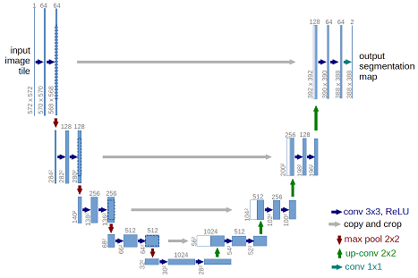

# U-Net: three-class image segmentation

Train the repository U-Net on paired RGB images and indexed masks using
TensorFlow/Keras. The main workflow is **trainUnet.ipynb**.



## Files included

| File | Purpose |
| --- | --- |
| `trainUnet.ipynb` | Dataset validation, preprocessing, training, evaluation, and prediction plots. Run this notebook for the new dataset. |
| `model.py` | U-Net architecture; supports binary and multiclass output, configurable filter width, learning rate, and dropout. |
| `data.py` | Shared validation, splitting, RGB/indexed-mask loading, prediction saving, and plotting helpers used by both notebooks and main.py. Original membrane helpers are retained. |
| `dataPrepare.ipynb` | Inspect the new dataset, preview masks, check resized batches, and save runs/prepared_dataset.json for training. |
| `main.py` | Shared preparation, training, and evaluation functions imported by trainUnet.ipynb; also a runnable CLI for the new dataset. |
| `requirements.txt` | Python libraries for training and notebook execution. |
| `.gitignore` | Excludes local environments, datasets, training artifacts, logs, and generated images. |
| `.gitattributes` | Git text-file normalization rules. |
| `img/u-net-architecture.png` | Architecture illustration retained in the repository. |
| `LICENSE` | Repository license. |

## 1. Set up the environment (Windows PowerShell)

Open a terminal in the repository folder. Python 3.11 is the verified environment.

```powershell
py -3.11 -m venv .venv
.\.venv\Scripts\python.exe -m pip install -r requirements.txt
.\.venv\Scripts\python.exe -m pip check
```

If `.venv` already exists, skip the first command. Optionally activate it:

```powershell
.\.venv\Scripts\Activate.ps1
```

The commands using `.venv\Scripts\python.exe` also work without activation.
In VS Code, install the Python and Jupyter extensions if needed.

## 2. Place your dataset locally

Datasets are not included in Git. Put the images and masks in this layout:

```text
data/
└── 936/
    ├── data/
    │   ├── 1.png
    │   ├── 2.png
    │   └── ...
    └── mask/
        ├── 1.png
        ├── 2.png
        └── ...
```

Each RGB image must have a same-name, same-size single-channel PNG mask.
Masks contain integer class IDs **0, 1, 2**, not normalized pixel values.
The notebook checks filenames, dimensions, and IDs before training.
Semantic class names must come from the dataset documentation.

## 3. Run trainUnet.ipynb

1. Open the repository folder in VS Code. First open `dataPrepare.ipynb`, select `.venv`, and run all cells to inspect the dataset. Then open `trainUnet.ipynb`.
2. Click **Select Kernel → Python Environments** and choose `.venv`.
3. Restart the kernel after editing `model.py` so the new code is imported.
4. Check the configuration cell, then click **Run All**.
5. Confirm that the first cell prints the project's `.venv\Scripts\python.exe`.
6. Read the training logs and the image / ground-truth / prediction comparison. The preparation manifest is used when its dataset and limit match; otherwise training performs its own validation with the same data.py helper.

If the environment is not listed, register its kernel:

```powershell
.\.venv\Scripts\python.exe -m ipykernel install --user --name unet-venv --display-name "Python (.venv U-Net)"
```

Select **Python (.venv U-Net)** and run all cells from the top.
TensorFlow runs on CPU in the verified native Windows environment.

### Default five-image sanity run

The configuration cell contains:

```python
DATASET = Path('data/936')
LIMIT = 5
EPOCHS = 120
IMAGE_SIZE = 128
BATCH_SIZE = 4
BASE_FILTERS = 16
LEARNING_RATE = 1e-3
DROPOUT_RATE = 0.0 if LIMIT is not None else 0.5
```

This selects pairs 1 through 5, resizes RGB images to 128x128 and masks with
nearest-neighbor interpolation, and trains a three-class softmax model using
sparse categorical cross-entropy. A learning-rate callback reduces the rate
if validation loss stops improving. Evaluation reloads the best checkpoint.

All five images are used for training and evaluation in this mode. Its accuracy
and Dice scores show whether the model can fit these samples; they do **not**
measure unseen-image performance. Longer training and disabling dropout help
this tiny run learn visible segmentation instead of predicting only class 0.

### Train on all 936 pairs

Set `LIMIT = None` in the configuration cell, restart the kernel, and run all
cells. This enables the fixed-seed split: 673 training, 75 validation, and
188 held-out test pairs. Dropout becomes 0.5. Adjust `EPOCHS` to your training
budget. Full-dataset training takes longer than the five-image run.

## 4. Find the generated results

Every run creates a new timestamped directory under `runs/`:

```text
runs/notebook_five_images_<timestamp>/
├── best.keras                   # Best validation-loss model
├── config.json                  # Settings and interpreter used
├── split.json                   # Selected sample IDs
├── training.csv                 # Epoch logs
├── history.json                 # Training history
├── metrics.json                 # Accuracy, loss, Dice, and class counts
├── prediction_comparison.png    # Images, true masks, and predictions
└── predictions/
    ├── 1_mask.png               # Predicted integer class IDs
    ├── 1_color.png              # Display-color rendering
    └── ...
```

The folder prefix remains `notebook_five_images_` even when `LIMIT=None`;
`config.json` and `split.json` record the actual selection. Colors are only
visualization colors. The notebook shows up to five comparisons and saves
up to six prediction pairs. Executed verification notebooks are saved locally as
`runs/dataPrepare_executed_local.ipynb` and `runs/trainUnet_executed_local.ipynb`.
Open these copies to view saved outputs. Versioned notebooks keep their code
without embedded dataset images or results.

To build the model and print its summary without training:

```powershell
.\.venv\Scripts\python.exe model.py
```

## Shared workflow and optional CLI

```text
dataPrepare.ipynb -> data.py -> runs/prepared_dataset.json
trainUnet.ipynb -> main.py -> model.py
                       -> data.py -> images, masks, predictions
```

The preparation notebook is a separate first step, rather than being imported
as a Python module. Its manifest is consumed by the training functions.
Dataset loading and prediction code is shared instead of duplicated in the
notebooks. The notebook keeps configuration and stage-by-stage calls visible.

The same workflow can run from the terminal:

```powershell
.\.venv\Scripts\python.exe main.py --limit 5 --epochs 120
```

For full-dataset training with held-out evaluation:

```powershell
.\.venv\Scripts\python.exe main.py --all-images --epochs 120
```

CLI runs save their results under `runs/cli_<timestamp>/`; no separate
train/test Python scripts are needed. Use `--help` to see the available options.

## GitHub exclusions

Commit the source files, notebook code, requirements, documentation, and
architecture illustration. `.gitignore` excludes `data/`, `runs/`, `.venv/`,
Python/Jupyter caches, model artifacts, dataset archives, logs, and sample
images under `img/` except the architecture illustration.

Dataset and result files that were previously tracked have been removed from
the Git index; their local copies remain. This changes the next commit and
does not erase files from older commits or an existing GitHub history.

Notebook outputs can embed dataset images even when their folders are ignored.
Before committing a newly executed notebook, use **Clear All Outputs** and save
it. Keep an executed copy under the ignored `runs/` folder if needed.

## Reference

Based on the repository's original Keras implementation of
[U-Net: Convolutional Networks for Biomedical Image Segmentation](https://lmb.informatik.uni-freiburg.de/people/ronneber/u-net/).
